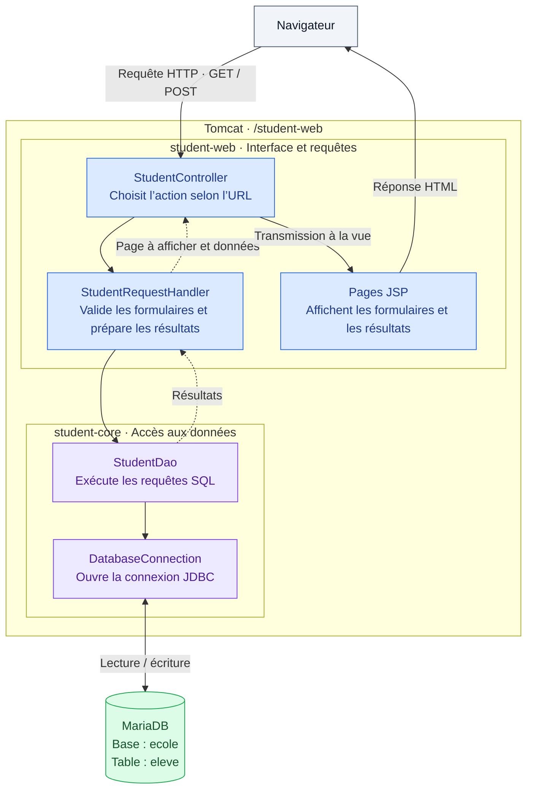

# Architecture de l’application

L’application permet d’ajouter des élèves, de les rechercher par numéro et de les lister.
Elle utilise Java EE : des **Servlets** reçoivent les requêtes, des **JSP** produisent les pages HTML et **JDBC** exécute les requêtes SQL.

## Vue d’ensemble



Le serveur produit directement les pages HTML. Les routes ci-dessous servent des pages et des formulaires, sans API JSON.

## Composants et fichiers

| Emplacement | Rôle |
| --- | --- |
| `student-web/src/main/java/.../web/controller/StudentController.java` | Reçoit les requêtes GET et POST et choisit la page JSP. |
| `student-web/src/main/java/.../web/handler/StudentRequestHandler.java` | Valide les champs, appelle le DAO et transmet les résultats aux pages. |
| `student-web/src/main/webapp/index.jsp` | Page d’accueil. |
| `student-web/src/main/webapp/WEB-INF/views/` | Formulaires, listes, confirmations et page d’erreur. Ces JSP ne sont pas accessibles directement par URL. |
| `student-web/src/main/webapp/WEB-INF/menu.jsp` | Menu partagé entre les pages. |
| `student-web/src/main/webapp/resources/` | Feuille de style et image. |
| `student-core/src/main/java/.../domain/Student.java` | Objet Java représentant un élève. |
| `student-core/src/main/java/.../persistence/StudentDao.java` | Requêtes SQL de gestion des élèves. DAO signifie « objet d’accès aux données ». |
| `student-core/src/main/java/.../persistence/DatabaseConnection.java` | Connexion JDBC, configurée par les variables d’environnement. |
| `student-core/src/main/java/.../result/` | Résultats : un élève (`StudentResult`), une liste (`StudentListResult`) et un code d’état (`OperationStatus`). |
| `servlet-demo/` | Petite application indépendante de démonstration des Servlets. |
| [database/schema.sql](database/schema.sql) | Création de la table des élèves. |
| [compose.yaml](compose.yaml) et [Dockerfile](Dockerfile) | Construction et démarrage de Tomcat et MariaDB. |
| `scripts/` | Compilation, lancement local et vérifications de l’accès à la base. |

Les chemins Java abrégés par `...` commencent par `com/s4m/jee/studentmanagement`.
Le module `student-web` dépend de `student-core`, qui ne dépend pas du module web.

## Routes

Adresse de base en local : **http://localhost:8080/student-web**.
GET ouvre une page ; POST envoie un formulaire.

| Route | GET | POST |
| --- | --- | --- |
| `/` | Accueil (`index.jsp`). | — |
| `/students` | Formulaire pour demander la liste. | Affiche tous les élèves (`student-list.jsp`). |
| `/students/new` | Formulaire d’ajout. | Ajoute l’élève et affiche une confirmation (`student-created.jsp`), ou revient au formulaire en cas de saisie invalide ou de numéro déjà présent. |
| `/students/search` | Formulaire de recherche. | Recherche par numéro et affiche le résultat (`student-search-result.jsp`). |
| `/students/delete` | Page d’erreur. | Page d’erreur : action non implémentée dans l’interface. |
| `/students/update` | Page d’erreur. | Page d’erreur : action non implémentée dans l’interface. |

Les routes `/students…` sont déclarées par l’annotation `@WebServlet` de `StudentController`.
Le contrôleur transmet la requête à la JSP avec un `forward` : l’URL du navigateur reste celle de la route appelée.

La démonstration séparée possède sa propre adresse :

| URL | Rôle |
| --- | --- |
| `/servlet-demo/` | Page de formulaires (`index.html`). |
| `/servlet-demo/hello` | Servlet `HelloServlet`, qui traite les données du formulaire et renvoie du HTML. |

## Base de données

La base **`ecole`** contient une seule table applicative : **`eleve`**. Il n’y a pas de relation entre tables.

| Colonne SQL | Type | Champ dans `Student` | Rôle |
| --- | --- | --- | --- |
| `num` | `VARCHAR(255)`, clé primaire | `number` | Numéro unique de l’élève, obligatoire. |
| `no` | `INT`, facultatif | `roomNumber` | Numéro de salle ; fixé à `0` par le formulaire d’ajout actuel. |
| `nom` | `VARCHAR(255)`, obligatoire | `name` | Nom de l’élève. |
| `age` | `INT`, obligatoire | `age` | Âge de l’élève. |
| `adresse` | `VARCHAR(1000)`, facultatif | `address` | Adresse de l’élève. |

`StudentDao` propose aussi la recherche par nom, salle ou année de naissance, la suppression et la modification de l’adresse ou de la salle. Ces opérations ne sont pas exposées par les formulaires actuels.

Les résultats portent un code : `1` = succès, `0` = aucun résultat, `-1` = erreur de base de données, `-2` = erreur générale ou doublon.

## Exemple : ajouter un élève

1. Le navigateur ouvre `GET /student-web/students/new` et reçoit le formulaire.
2. Le formulaire envoie un `POST` à la même URL avec `numelev`, `nomelev`, `agelev` et `adresselev`.
3. Le handler vérifie que le numéro et le nom sont renseignés et que l’âge est un entier positif ou nul.
4. Il demande au DAO si le numéro existe déjà, puis insère le nouvel élève si le numéro est libre.
5. Le contrôleur transmet le résultat à la JSP, qui affiche la confirmation ou le message d’erreur.

## Exécution et configuration

```bash
docker compose up -d --build --wait
```

Avant le premier lancement, copier `.env.example` vers `.env` et remplacer les deux mots de passe d’exemple. Ce fichier privé est exclu de Git.

Docker Compose démarre deux services :

| Service | Contenu | Accès |
| --- | --- | --- |
| `app` | Tomcat, `student-web` et `servlet-demo`. | Navigateur : `localhost:8080`. |
| `db` | MariaDB 10.11, base `ecole`. | Depuis `app` : `db:3306` ; depuis la machine : `127.0.0.1:8889`. |

La connexion utilise `DB_URL`, `DB_USER` et `DB_PASSWORD`. Compose fournit ces valeurs ; pour un lancement local sans Docker, voir [.env.example](.env.example) et les instructions du [README](README.md).

Le fichier `database/schema.sql` initialise la table lors de la première création de la base. Les données sont conservées dans le volume Docker `ecole-db`, y compris après `docker compose down`.
